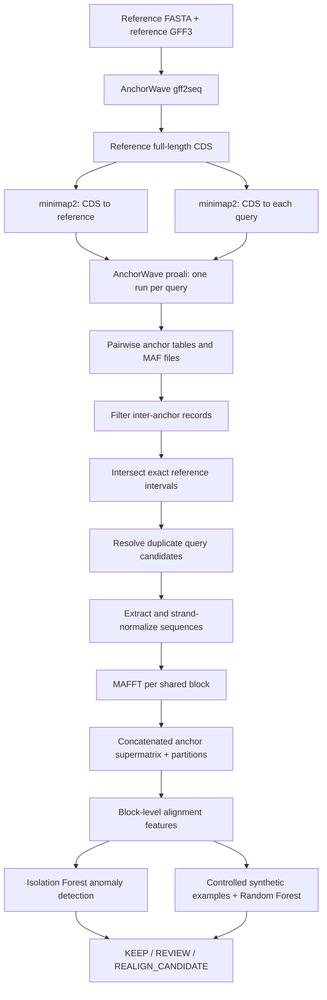

# Multi-Species-Alignment

# Reference-Centred Multi-Species AnchorWave Alignment and QC

A Python command-line workflow for integrating **independent pairwise AnchorWave genome alignments** into a reference-centred, multi-species anchor alignment, followed by **alignment-block quality triage**.

The workflow identifies anchor intervals shared by all query genomes, extracts the corresponding sequences, aligns each shared block with MAFFT, concatenates the blocks into a supermatrix, and evaluates block-level characteristics using an Isolation Forest and a Random Forest trained on controlled synthetic perturbations.

> **Scope:** The output is a concatenated alignment of *shared anchor regions*, **not** a continuous whole-genome multiple alignment. Quality-control labels prioritize inspection; they do **not** establish biological correctness or a validated alignment-error rate.
>
> **Status:** Research workflow. The example commands and configuration below describe the uploaded implementation; they are not a claim that any particular reported scientific result has been independently reproduced.

## Contents

- [Overview](#overview)
- [Requirements and installation](#requirements-and-installation)
- [Input data](#input-data)
- [Configuration](#configuration)
- [Running the pipeline](#running-the-pipeline)
- [Outputs](#outputs)
- [Methods](#methods)
- [Reproducibility and limitations](#reproducibility-and-limitations)
- [Troubleshooting](#troubleshooting)
- [References and citation](#references-and-citation)

## Overview



### Main capabilities

- Run **AnchorWave `gff2seq`**, **minimap2**, and **AnchorWave `proali`** for multiple reference-query comparisons.
- Find shared anchors using an **exact** `(reference chromosome, start, end)` coordinate key.
- Select a single query candidate for duplicate reference keys, while recording alternatives.
- Reverse-complement negative-strand query intervals to reference orientation.
- Independently align each shared region using **MAFFT `--auto`**.
- Create a four-species (or, more generally, reference-plus-queries) anchor supermatrix with a block-partition table.
- Calculate alignment-size, gap, ambiguity, conservation, entropy, nucleotide-identity, mapping, and duplication features.
- Detect unusual real-block feature profiles using **Isolation Forest**.
- Benchmark recognition of five *synthetically defined* alignment patterns using a **source-grouped Random Forest** evaluation.
- Assign operational labels: **`KEEP`**, **`REVIEW`**, and **`REALIGN_CANDIDATE`**.

## Requirements and installation

### Software

- **Python 3.11** recommended (the code uses Python 3.10+ type-union syntax).
- [AnchorWave](https://github.com/baoxingsong/anchorwave)
- [minimap2](https://github.com/lh3/minimap2)
- [MAFFT](https://mafft.cbrc.jp/alignment/software/)
- Python packages: `numpy`, `pandas`, `scikit-learn`, and `joblib`.
- macOS or Linux with sufficient memory and disk space for genome alignments and uncompressed inputs.

For reproduction of the associated manuscript workflow, the stated versions are **AnchorWave 1.3.1**, **minimap2 2.31-r1302**, **MAFFT 7.526**, and **Python 3.11.16**. Record the actual versions used; a package resolver may install different builds or patch versions.

A Conda installation example:

```bash
conda create -n anchorwave_repro -c conda-forge -c bioconda \
  python=3.11 anchorwave=1.3.1 minimap2=2.31 \
  mafft numpy pandas scikit-learn joblib -y
conda activate anchorwave_repro

anchorwave --version
minimap2 --version
mafft --version
python --version
```

**Note:** The script checks for all three executable tools even when running the `pairwise` command, so MAFFT must be installed for its initial validation step.

### Repository layout

Save the Python source as `anchorwave_multi.py` (replace that name in the examples if your file is named differently):

```text
project/
├── anchorwave_multi.py
├── config.json
└── input/
    ├── Arabidopsis_thaliana.TAIR10.dna.toplevel.fa
    ├── Arabidopsis_thaliana.TAIR10.63.gff3
    ├── Arabidopsis_halleri.Ahal2.2.dna.toplevel.fa
    ├── Brassica_rapa.Brapa_1.0.dna.toplevel.fa
    └── Brassica_juncea.ASM1870372v1.dna.toplevel.fa
```

## Input data

The workflow needs:

1. One reference genome **FASTA** and its gene annotation **GFF3**.
2. At least **two** query genome FASTA files. Three queries produce the four-species example below.
3. Available AnchorWave, minimap2, and MAFFT executables.

Only the **reference GFF3** is required for CDS extraction. A query GFF3 can be supplied optionally, but the pairwise commands do not use it.

### Example plant genomes

The study configuration uses Ensembl Plants **release 63**:

| Role | Species | Assembly |
| --- | --- | --- |
| Reference | *Arabidopsis thaliana* | TAIR10 |
| Query 1 | *Arabidopsis halleri* | Ahal2.2 |
| Query 2 | *Brassica rapa* | Brapa_1.0 |
| Query 3 | *Brassica juncea* | ASM1870372v1 |

Use the same genome releases and masking status when reproducing an earlier run; changing the assemblies or annotations can change anchor recovery.

### Uncompress the inputs first

**Important:** Although AnchorWave itself may accept compressed input, **this Python wrapper rejects `.gz` reference and query inputs** and uses an indexer that expects uncompressed FASTA.

For example, if the downloads are under `input/`:

```bash
for file in input/*.gz; do
  gzip -dc "$file" > "${file%.gz}"
done
```

Keep the downloaded `.gz` files for provenance and record their SHA-256 checksums. Make sure there is enough disk space for both the compressed and uncompressed copies.

## Configuration

The program requires a **JSON configuration file**, passed through `--config`. Paths in this example are relative to `project_dir`, which itself is resolved relative to the directory containing `config.json`.

Create a file named `config.json`:

```json
{
  "project_dir": ".",
  "output_dir": "results/awmulti",
  "logs_dir": "logs/awmulti",
  "tools": {
    "anchorwave": "anchorwave",
    "minimap2": "minimap2",
    "mafft": "mafft"
  },
  "reference": {
    "name": "thaliana",
    "fasta": "input/Arabidopsis_thaliana.TAIR10.dna.toplevel.fa",
    "gff3": "input/Arabidopsis_thaliana.TAIR10.63.gff3"
  },
  "queries": [
    {
      "name": "halleri",
      "fasta": "input/Arabidopsis_halleri.Ahal2.2.dna.toplevel.fa",
      "R": 1,
      "Q": 1
    },
    {
      "name": "rapa",
      "fasta": "input/Brassica_rapa.Brapa_1.0.dna.toplevel.fa",
      "R": 1,
      "Q": 1
    },
    {
      "name": "juncea",
      "fasta": "input/Brassica_juncea.ASM1870372v1.dna.toplevel.fa",
      "R": 1,
      "Q": 1
    }
  ],
  "parameters": {
    "minimap2_threads": 4,
    "anchorwave_threads": 1,
    "mafft_jobs": 4,
    "mafft_threads": 1,
    "min_exon_length": 20,
    "include_novel_anchors": true,
    "write_block_fastas": true
  },
  "anchor_matching": {
    "method": "exact",
    "duplicate_policy": "best_score"
  }
}
```

**Parameter notes**

| Setting | Meaning |
| --- | --- |
| `reference.name` / `queries[].name` | Unique identifiers used in FASTA records and output paths |
| `queries[].R`, `queries[].Q` | Maximum reference/query alignment depth passed to `proali`; default `1` each |
| `minimap2_threads` | Number of threads for minimap2; default `4` |
| `anchorwave_threads` | Number of threads passed to AnchorWave `proali`; default `1` |
| `mafft_jobs` | Number of block alignments scheduled concurrently; default `4` |
| `mafft_threads` | Threads per MAFFT invocation; default `1` |
| `min_exon_length` | Optional `-m` passed to `gff2seq` and `proali`; if omitted, tool defaults apply |
| `include_novel_anchors` | Whether to retain `localAlignment` records during parsing; does **not** disable novel-anchor discovery by `proali` |
| `write_block_fastas` | Retain extracted, pre-MAFFT block FASTAs; default `true` |
| `anchor_matching.method` | Currently only `exact` is implemented |
| `anchor_matching.duplicate_policy` | Currently only `best_score` is implemented |

The selection of `R` and `Q` should be justified for the species and their duplication histories; the example reproduces the **specified settings**, not necessarily the biologically optimal settings.

### Reuse completed mapping files

Optional config keys let the script reuse existing outputs when they are present and nonempty. For example, inside `reference`:

```json
"cds": "results/ref_cds.fa",
"sam": "results/ref.sam"
```

And inside the `halleri` query object:

```json
"sam": "results/halleri/query.sam"
```

You can also specify output paths for `anchors`, `maf`, and `fragments_maf` on each query. **Reuse is based on file existence and nonzero size, not content verification**; ensure reused files match the current genomes and parameters.

## Running the pipeline

Run the following commands from the project directory, with the Conda environment activated.

### 1. Validate inputs and tools

```bash
python anchorwave_multi.py check --config config.json
```

This checks declared input paths, verifies that genome files are uncompressed, checks reference annotation sequence IDs against the reference FASTA, and locates the required executables.

### 2. Preview commands without executing them

```bash
python anchorwave_multi.py pairwise --config config.json --dry-run
```

This prints the steps that would run. Stages whose output files are already considered complete may be skipped in the preview.

### 3. Generate pairwise alignments

```bash
python anchorwave_multi.py pairwise --config config.json
```

Runs CDS extraction and reference mapping if needed, then runs minimap2 and AnchorWave `proali` for **every query listed in `config.json`**. The command does **not** provide a built-in option to run just one named query.

### 4. Merge shared anchors and generate the supermatrix

```bash
python anchorwave_multi.py merge --config config.json
```

Parses retained anchors, intersects exact reference keys, resolves duplicate candidates, extracts sequences, performs independent MAFFT alignments, and concatenates the results.

Alternatively, do pairwise alignment and merging in one command:

```bash
python anchorwave_multi.py run --config config.json
```

### 5. Assess real-block quality using Isolation Forest

```bash
python anchorwave_multi.py qc --config config.json
```

Defaults: 500 trees, `contamination=0.05`, `random_state=42`.

### 6. Generate the synthetic benchmark and train the Random Forest

```bash
python anchorwave_multi.py benchmark --config config.json
```

Defaults: select up to 600 source blocks, create five classes per source, use a source-grouped 80/20 train/test split, and train a 600-tree Random Forest.

### 7. Assign final triage labels

```bash
python anchorwave_multi.py triage --config config.json
```

Defaults: KEEP probability threshold `0.70` and REALIGN_CANDIDATE probability threshold `0.70`, combined with the Isolation Forest flag.

### Other command combinations

```bash
# Run only the three QC stages on existing multiple alignments
python anchorwave_multi.py analyse --config config.json

# Run pairwise, merge, QC, benchmark, and triage
python anchorwave_multi.py all --config config.json

# Force regeneration of relevant stages; can be computationally expensive
python anchorwave_multi.py run --config config.json --force
```

**Caution:** Full genome alignment can be CPU-, memory-, and disk-intensive. Set thread counts for the machine or HPC allocation. Avoid `--force` unless regeneration is intentional.

### Command-line reference

```text
python anchorwave_multi.py {check,pairwise,merge,run,qc,benchmark,triage,analyse,all} --config FILE
  [--force] [--dry-run]
  [--contamination FLOAT] [--random-state INT]
  [--blocks INT] [--min-alignment-length INT]
  [--max-alignment-length INT] [--test-fraction FLOAT]
  [--keep-threshold FLOAT] [--realign-threshold FLOAT]
  [--model PATH]
```

Some options affect only their associated stage. For instance, `--blocks` affects the synthetic benchmark, while `--contamination` affects Isolation Forest fitting.

## Outputs

Unless overridden in `config.json`, the pipeline writes:

```text
results/awmulti/
├── reference/
│   ├── reference_cds.fa
│   └── reference.sam
├── pairwise/
│   ├── halleri/
│   │   ├── query.sam
│   │   ├── anchors.tsv
│   │   ├── alignment.maf
│   │   └── fragments.maf
│   ├── rapa/
│   │   └── ...
│   └── juncea/
│       └── ...
├── multispecies/
│   ├── shared_anchors_exact.tsv
│   ├── duplicate_anchor_candidates.tsv
│   ├── blocks/
│   ├── aligned_blocks/
│   ├── all_shared_anchors.aligned.fa
│   ├── anchor_partitions.tsv
│   ├── ml_qc/
│   │   ├── alignment_block_features.tsv
│   │   ├── alignment_block_anomalies.tsv
│   │   └── isolation_forest_features.txt
│   ├── synthetic_qc/
│   │   ├── synthetic_features.tsv
│   │   ├── metrics.json
│   │   ├── test_predictions.tsv
│   │   ├── confusion_matrix.tsv
│   │   ├── classification_report.txt
│   │   ├── feature_importance.tsv
│   │   └── synthetic_qc_model.joblib
│   └── final_qc/
│       ├── real_block_qc_predictions.tsv
│       ├── blocks_for_review.tsv
│       ├── realign_candidates.tsv
│       └── qc_summary.json
└── run_manifest.json

logs/awmulti/
├── reference/
├── pairwise/
└── mafft/
```

Key files:

| File | Description |
| --- | --- |
| `alignment.maf` | AnchorWave pairwise genome alignment |
| `fragments.maf` | Pairwise alignment at the anchor/inter-anchor fragment level |
| `anchors.tsv` | AnchorWave anchor data used by the merge parser |
| `shared_anchors_exact.tsv` | Selected coordinate-matched anchor intervals and query mappings |
| `duplicate_anchor_candidates.tsv` | Alternative query mapping candidates for duplicate reference keys |
| `all_shared_anchors.aligned.fa` | Reference-centred concatenated multiple alignment of shared anchors |
| `anchor_partitions.tsv` | Mapping from concatenated alignment columns to anchor intervals |
| `alignment_block_features.tsv` | Block-level numerical features and anomaly information |
| `metrics.json` | Synthetic held-out classification performance |
| `qc_summary.json` | Real-block triage counts |
| `run_manifest.json` | Configuration checksum, versions, paths, parameters, timing and merge summaries |

**Note:** Pairwise-only mode generates the AnchorWave outputs but does **not** directly print the manuscript-style count of retained anchor records. Those counts are calculated during `merge`, and the parser's interpretation of the anchor-file format should be verified against real output.

## Methods

### Exact-anchor integration

An anchor is considered shared if its **reference chromosome, start and end positions** are identical across all configured pairwise comparisons. This deliberately conservative rule can exclude biologically related alignments whose reference boundaries differ by even one nucleotide.

Duplicate reference keys are grouped within each query. The chosen candidate is ranked using AnchorWave score, query interval length, and deterministic coordinate-based tie-breakers; alternative candidates are retained in a separate report. Query intervals on the minus strand are reverse-complemented before MAFFT.

### Alignment-block quality features

The script summarizes alignment length, ungapped sequence representation, gap fractions and runs, ambiguous bases, conservation, variable columns, entropy, pairwise nucleotide identity, AnchorWave scores, strand orientation and duplicate-candidate burden. Pairwise identity is evaluated only over columns where **both sequences contain unambiguous A/C/G/T bases**.

### Isolation Forest

An Isolation Forest with **500 trees** and default `contamination=0.05` identifies unusual real-block feature vectors. Approximately 5% of blocks are expected to be flagged by configuration; this is **not** an estimated biological error rate.

### Synthetic Random Forest benchmark

The benchmark selects up to **600 non-anomalous** source blocks with alignment lengths from **300 to 10,000** columns, then generates five examples per source:

| Label | Modification |
| --- | --- |
| `unaltered` | No change |
| `low_information_like` | Replace nucleotides in a window with `N` |
| `misalignment_like` | Circularly rotate a sequence window |
| `structural_deletion_like` | Replace nucleotides in a window with `-` |
| `foreign_sequence_like` | Change selected nucleotides to different random A/C/G/T bases |

A `GroupShuffleSplit` prevents examples derived from the same source block from appearing in both training and held-out test groups. The model has **600 trees** and reports accuracy, balanced accuracy, macro F1, macro one-versus-rest ROC-AUC, a classification report and a confusion matrix.

**The benchmark evaluates recognition of constructed patterns, not detection of validated naturally occurring alignment errors.** The foreign-sequence-like modification does not import sequence from another organism; it substitutes alternative random nucleotides.

### Triage rules

| Output label | Condition |
| --- | --- |
| `KEEP` | Predicted `unaltered` with probability **≥ 0.70**, and **not** flagged by Isolation Forest |
| `REALIGN_CANDIDATE` | Predicted `misalignment_like` with probability **≥ 0.70**, **and** flagged by Isolation Forest |
| `REVIEW` | All other cases |

The program **does not automatically realign** `REALIGN_CANDIDATE` blocks; the label identifies candidates for separate inspection or alternative alignment.

## Reproducibility and limitations

This implementation has several important constraints:

1. **Input compression:** The wrapper rejects compressed genome/annotation inputs. Decompress before use.
2. **Output reuse:** Existing nonempty intermediates may be skipped. The workflow does not check whether their content matches the current inputs, so use fresh output paths or `--force` for a clean rerun.
3. **Anchor-file format:** The parser expects a specific tab-delimited AnchorWave format with `refChr` as its header and `interanchor` in its block-type field. Inspect new AnchorWave output before relying on automated counts.
4. **Exact matching:** Anchors with different boundaries are excluded, even where they may be biologically homologous.
5. **Duplication:** One selected candidate per species may omit relevant paralogous/homeologous copies.
6. **Coverage:** Inter-anchor regions are not included in the concatenated supermatrix.
7. **Synthetic labels:** QC classifications are operational triage, not ground-truth biological error labels.
8. **Evaluation:** The benchmark uses a single grouped train/test split. The current code imputes missing values before splitting, which can leak information from the test feature distribution into preprocessing; a train-only imputation pipeline is preferable for formal validation.
9. **Provenance:** The run manifest hashes the JSON configuration but does not automatically hash every genome input or every output, and `all` writes its manifest before running the later QC stages.
10. **Validation:** Results on additional datasets, against independent curated error examples, and against joint whole-genome aligners remain separate validation tasks.

For a reproducibility study, preserve downloaded input checksums, full software/package versions, the exact JSON configuration, command logs, pairwise anchor files, and every machine-learning output. Do not treat agreement with a manuscript number alone as proof of biological accuracy.

## Troubleshooting

**`Compressed input is not supported`**  
Decompress all genome FASTA and reference GFF3 inputs and update their paths in `config.json`.

**`Executable not found on PATH: mafft`**  
Install MAFFT in the active environment. The script checks all required tools, even for the pairwise stage.

**`queries must contain at least two query species`**  
The current configuration parser requires at least two query genomes. To run only one AnchorWave comparison, use AnchorWave directly or modify the script.

**No exact shared reference anchors found**  
Confirm assembly builds, reference identity, `R`/`Q` settings, pairwise anchor-file format and parsing behavior. Exact matching can yield no common intervals if coordinate boundaries differ.

**Unexpected results after changing inputs**  
Use a new output directory or regenerate the relevant stages with `--force`; existing nonempty files may otherwise be reused.

**Long runtimes or excessive memory use**  
Reduce `anchorwave_threads`, `mafft_jobs` or `mafft_threads`, and ensure sufficient scratch space for uncompressed reference and query genomes. AnchorWave genome alignment can be resource-intensive.

## References and citation

### Core software

- Song B, et al. **AnchorWave: Sensitive alignment of genomes with high sequence diversity, extensive structural polymorphism, and whole-genome duplication.** *PNAS* (2022). [doi:10.1073/pnas.2113075119](https://doi.org/10.1073/pnas.2113075119)
- Li H. **Minimap2: pairwise alignment for nucleotide sequences.** *Bioinformatics* (2018). [doi:10.1093/bioinformatics/bty191](https://doi.org/10.1093/bioinformatics/bty191)
- Katoh K, Standley DM. **MAFFT Multiple Sequence Alignment Software Version 7: Improvements in Performance and Usability.** *Molecular Biology and Evolution* (2013). [doi:10.1093/molbev/mst010](https://doi.org/10.1093/molbev/mst010)
- Pedregosa F, et al. **Scikit-learn: Machine Learning in Python.** *JMLR* (2011), 12:2825–2830.

### Associated manuscript

*Reference-Centred Multi-Species Alignment and Quality Triage of Shared AnchorWave Regions* — research manuscript draft. Add a final publication citation or DOI when available; do not describe the draft as peer reviewed or published before acceptance.

### License

No license was provided with the uploaded Python source. Add an explicit `LICENSE` file before publishing the repository, and do not assume that the license of an upstream dependency automatically applies to this workflow.
